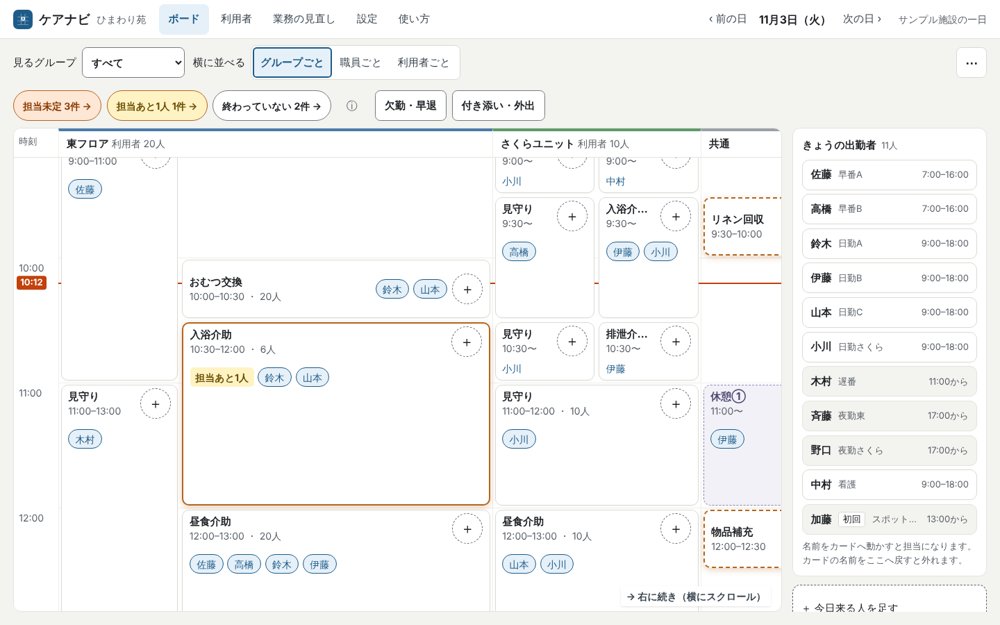
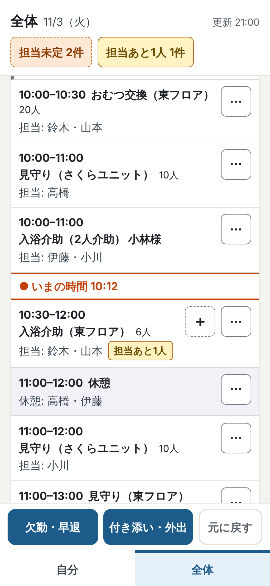
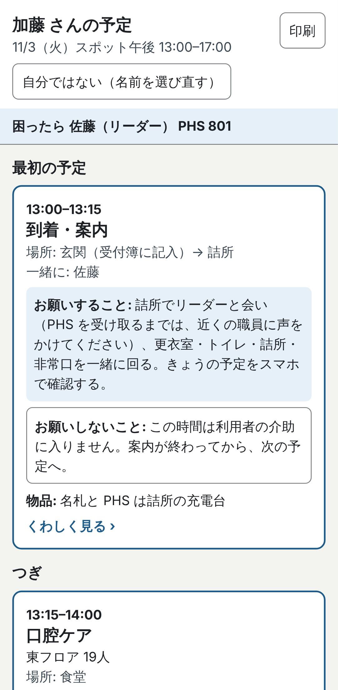
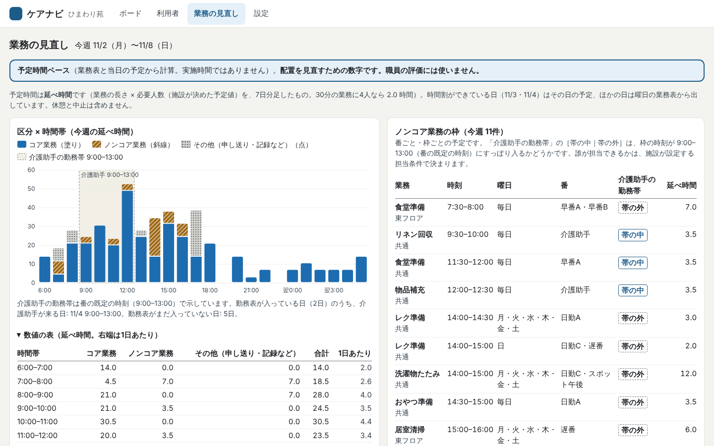

# ケアナビ — 仕事に、人を付ける。

介護現場の一日を「業務の時間割」にして、必要な仕事に人を当て、一人ひとりに「いつ・どこで・誰に・何を」を案内する道具です。介護記録ではなく、**介護業務のナビゲーション**。介護記録ソフトの代わりにはなりません。製品の中で AI は使いません（Claude Code を使って作った、AI を使わない道具です）。

Built with Claude: Japan 2026（2026-11-02〜11-08）の提出作品として、新規に開発しています。



| 全体（リーダーのスマホ） | 自分の予定（応援の方のスマホ） |
|---|---|
|  |  |



## 60 秒で試す

```bash
npm install
npm run dev        # http://localhost:3000
```

1. 最初の画面で **「サンプル施設で試す」** を押す（入力なし。架空の施設「ひまわり苑」が入ります）。
2. ボードで、右の「きょうの出勤者」から名前をつまみ、**「担当あと1人」** のカードに落とす。バッジが消え、「元に戻す」が出ます。
3. ブラウザをスマホ幅（390px）にするか、別タブで `/me` を開き、いま落とした名前を選んで **「自分の予定」** を見る。付けたばかりの担当が「きょうの流れ」に入っています。

時刻を固定して見るときは `/board?now=10:12` のように `?now=` を付けます（現在時刻ラインは動きません）。

## 見せ場 3 つ

動くものはこの 3 つだけです（`docs/video-storyboard.md`）。それ以外は静かに、文字で示します。

1. **現在時刻ラインが進む。** ボードと「全体」の一覧に、いまの時刻の線が入ります。時刻が過ぎても業務を「終わった」扱いにはしません。「終わった」は人が 1 タップで付ける印で、終わりの時刻を過ぎて印の無い枠は「終わっていない n 件」として見出しに出ます。
2. **チップを落とすとバッジが消える。** 「担当未定」「担当あと n 人」は、施設が決めた必要人数と割当数の差分です。満たした枠には何も付きません。休憩には付けません。
3. **別の端末・別のタブに即反映。** ボードで付けた担当が、スマホの「自分の予定」にすぐ出ます。同じブラウザの別タブへは BroadcastChannel、別の端末へは施設コード（デモ用。認証ではありません）で同期します。

## 何ができるか

- **時間割（ボード）**: 縦が時間、横がユニット・フロア。個別（対象1名）・一括（対象複数）・共通（対象なし）・休憩を同じ画面に置き、各枠に施設が決めた必要人数を持たせます。割当が足りない枠は「担当未定」「担当あと n 人」と文字で出ます。
- **朝1分の準備**: 業務はあらかじめ番（早番A・日勤B・介護助手…）に束ねてあります。朝は先週の同じ曜日の番が入った帯で「この内容で作る」を押すだけで、全枠に担当が付きます。介護助手が休みの日は、その番の枠がそのまま「担当未定」で見えます。
- **割当の操作**: 職員チップをカードへドラッグ、またはカードの「担当を追加」から候補を選びます。候補は「問題なし／注意／勤務外・休み」の3段で、全員に理由が一文付きます。重なり・勤務外・休憩・担当条件・初回の方だけの配置は警告して許可。担当条件（例: 入浴担当可・看護師）は施設が業務の種類に決め、職員ごとに設定の「職員の担当条件」で付け外しします。等級や評価は持ちません。同じ人を同じ業務に二度は入れられません。すべての操作は「元に戻す」で戻せます。
- **変更10秒（リーダーのスマホ「全体」）**: 時間順の一覧の各行に「⋯」（中止・ずらす・担当を外す）、担当が足りない行に「＋」。画面下にクイック操作（欠勤・早退／付き添い・外出）と「元に戻す」。クイック操作は「こう変わります」のプレビューを見てから「この内容で決定」。休憩をずらすのは「⋯ → ずらす」です。
- **自分の予定（手元画面）**: 自分の「いまの時間の予定」「つぎ」「きょうの流れ」。業務を開くと、お願いすること／お願いしないこと、対象の方（お一人ずつの注意）、場所、一緒に入る人、手順、物品、困ったときの相談先。初日から段取りで迷わないための画面です。詰所の共有タブレットで名前を選んで使うこともできます。
- **「終わった」の印**（決定記録 0010）: 枠ごとに、担当の人かリーダーが 1 タップで「終わった」を付け外しします。時刻が過ぎただけでは付きません。誰が付けたかは画面に出しません。終わりの時刻を過ぎて印の無い枠は、ボードとリーダーの「全体」の見出しに「終わっていない n 件」と出て、押すとその枠へ移ります。
- **職員ビューと印刷**: 職員×時間で重なり・偏り・誰もいない時間帯を確認。そのまま A4 横の分担表として印刷できます。自分の予定も A4 で印刷できます。
- **業務の見直し（今週）**: 業務区分（コア／ノンコア）×時間帯の予定時間の図と数値の表、介護助手等の勤務帯との重なり、ノンコアの枠の一覧（番別・枠別）。予定時間ベースで、職員の評価には使いません。判断の言葉は出しません。数字は業務に付け、職員個人の内訳は出しません。業務表はボードの「今日を業務表として保存」で直します。

## 作らないもの（今回）

- 介護記録・申し送り（内容の記録）、記録の一覧・CSV・完了率などの率。持つのは枠ごとの「終わった」の印だけで、時刻が過ぎた予定を自動で「終わった」扱いにしません（決定記録 0010）。
- 介護記録ソフト等との連携、自動転記。
- 自動のシフト作成・配置、必要人数の推定、採用や評価の分析。
- 求人掲載、スポットワーカーのマッチング。
- 写真・動画、通知、複雑な帳票。
- 認証・権限（下記「保存と同期」を参照）。

## AIの境界

**ケアナビ本体は AI を使いません。** 外部の生成AIも音声認識も呼びません。施設のデータが外部へ送られることはなく、詰所のPCがオフラインでも同じに動きます。配置・適性・必要人数を判断するのは人で、道具は候補と理由を見せるだけです。

開発は Claude Code で行っています。設計の経緯・レビューの記録・決定記録は `docs/` にあります。将来、施設が明示的に有効化する任意の補助（利用者名を含まない文章の整形など）を検討する余地はありますが、今回は作りません。

## 始め方

```bash
npm install
npm run dev        # http://localhost:3000
npm test           # 単体テスト（配置チェック、バッジ文言、イベントの適用と取り消し）
npm run e2e        # Playwright（受け入れシナリオ）
npm run lint
npm run typecheck
npm run check:wording   # 製品に出る文字列の規則チェック
```

最初の画面で **「サンプル施設で試す」** を押すと、架空の施設「ひまわり苑」（東フロア20人・さくらユニット10人・職員12人）が入った状態で、すぐに時間割と配置を触れます。入力は要りません。利用者・職員の名前はすべて架空です。

自分の施設で始める場合は、設定で施設名とグループを入れ、利用者（名前・グループ・部屋）と職員（名前・職種・担当条件・PHS）を貼り付けるだけです。番、業務の種類、業務表（従来型／ユニット）が最初から入っています（サンプルの雛形を、入れたグループに並び順で当てはめます）。

## 保存と同期

- 状態は操作イベントの列から組み立てます。元に戻す操作は打ち消しイベントとして追記され、履歴は消えません。
- **ローカル**: ブラウザ内（localStorage）にイベント列として保存します。再読み込みしても残り、同じブラウザの別タブへは即時に反映されます。「サンプルに戻す」で初期状態に戻せます。データが大きくなれば IndexedDB へ移します。
- **端末間の同期**（決定記録 0009）: 設定の「この施設を同期する」で施設コード（6 文字。発行のたびに違う乱数）を発行すると、その端末の内容が Supabase の `events` テーブル（施設コードで絞る）に送られ、以後は同期で動きます。ほかの端末は「施設コードで参加」（QR か、コードの入力。はじめの画面にもあります）で同じ時間割を見ます。届いた変更は Realtime で即時に映り、「ほかの端末で変更がありました」と一言出ます。参加した端末はブラウザにキャッシュを持ち、届かないとき（Realtime が切れたときも）は「この端末の内容（未送信 n 件）」と出して動き続け、つながり直したら未送信を送り、届いていなかった分を取り直します。「この端末だけにする（同期をやめる）」は、いまの内容をその端末に写してから切ります（ほかの端末の内容はそのまま）。
  - 環境変数は `NEXT_PUBLIC_SUPABASE_URL` と `NEXT_PUBLIC_SUPABASE_ANON_KEY` の 2 つ（`.env.local` か、公開先の環境変数）。未設定ならローカルだけで動き、設定の同期の項目は出ません。鍵はリポジトリに入れません。
  - Supabase 側は `supabase/schema.sql` を SQL エディタで実行します（テーブル 1 つと Realtime）。
  - 2 端末の E2E（`e2e/sync.spec.ts`）は、環境変数があるときだけ走ります。

### 本番の要件（今回は作っていません）
- **認証と権限**: 施設コードは認証（暗証番号）ではありません。この版は anon キー（`NEXT_PUBLIC_`）がブラウザに配られ、行レベルのポリシーも `using (true)` なので、施設コードを知らなくてもすべての施設の行を読める状態です。**試用では架空の名簿だけを入れてください。実在の利用者・職員の名簿を入れた施設は、この版では同期しないでください。** 本番では職員ごとの認証、施設・役割ごとの権限（行レベルのポリシー）、施設コードの再発行と端末の切り離し、共有端末にデータを残さない設計が必要です。

### MVP の制限（正直に）
- **業務日**はカレンダー日です。時刻は業務日 0:00 起点の分で持ち、翌日分は 24:00 を超える値で表します（最大 48 時間）。夜勤帯の業務は、その夜勤が始まった業務日に属します。夜勤明けの人が翌朝にスマホを開くと、その夜勤の業務日（前日）の予定が出ます。翌朝のリーダーのスマホには、前日の夜勤の業務が「昨夜の夜勤の業務」として見るだけで出ます（変えるときは前日のボード）。夜勤明けの人の早退・欠勤は、翌日の画面からは入れられません。日をまたぐ予定の移動は作っていません。
- **施設コードは認証ではありません。** 同じ施設を見る端末をそろえるための合言葉で、試用の範囲で使ってください。
- 手元画面の利用者名は既定で「部屋番号＋姓」です。施設設定で変えられます。
- ボードは PC・タブレット向け、手元画面はスマホ向けです。

## 技術

Next.js（App Router）・TypeScript・Tailwind CSS・dnd-kit・ブラウザ内保存（localStorage＋BroadcastChannel）・Node の組み込みテストランナー・Playwright。

## 文書

| 文書 | 内容 |
|---|---|
| `docs/concept.md` | 構想書 |
| `docs/screens.md` | 画面仕様 |
| `docs/data-model.md` | データモデルとイベント設計 |
| `docs/checks.md` | 配置チェック仕様 |
| `docs/acceptance.md` | 受け入れ条件と E2E シナリオ |
| `docs/wording.md` | 表現の規則 |
| `docs/dev-process.md` | 開発の進め方（エージェント・レビューループ・フック） |
| `docs/decisions/` | 決定記録 |
| `docs/usability-script.md` | 試用の台本 |
| `docs/video-storyboard.md` | 動画の構成 |
| `docs/submission.md` | 提出文の下書き |

## 参考

厚生労働省 介護分野における生産性向上ポータルサイト「業務の明確化と役割分担」（https://www.mhlw.go.jp/kaigoseisansei/what/effort2.html）。ケアナビの時間割は、ここで示される「見える化 → ムリ・ムダ・ムラの整理 → マスターラインの引き直し → 手順と役割の再編」の流れを、日々の運用に埋め込むことを目指しています。効果は未検証の仮説です。

## ライセンス

MIT
